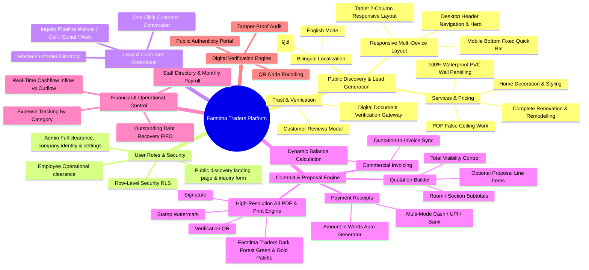

# Product Requirements Document (PRD)

## Project: Famtima Traders CRM, ERP & Public Marketing Platform
**Document Version:** 2.2.0  
**Status:** Approved & Implemented  
**Owner:** Anwar Khan (Famtima Traders, Bemetara, Chhattisgarh)  
**Target Platform:** Cross-Platform Responsive Web Application (Desktop, Tablet, Mobile)  
**Live Production URL:** [famtima-traders.vercel.app](https://famtima-traders.vercel.app)

---

## 1. Executive Summary & Objectives

### 1.1 Purpose
Famtima Traders is a premier interior decoration, false ceiling, and renovation firm operating in Bemetara and across Chhattisgarh. This platform automates and unifies the end-to-end commercial and public presence:
1. **Public Marketing & Lead Generation**: High-converting, bilingual (English & Hindi) responsive web portal with streamlined UI/UX, service catalogs, showcase portfolios, and instant WhatsApp estimate calculators.
2. **Back-Office CRM & ERP**: Multi-gateway authentication, lead management, section-grouped quotations with optional proposal items, invoice billing, multi-mode receipt tracking, FIFO-based debt settlement, employee payroll, expense tracking, real-time cashflow analytics.

### 1.2 Core Business Objectives
* **Regional Audience Reach & Clarity:** Provide an intuitive English / हिंदी toggle allowing local clients across Bemetara and Chhattisgarh to understand services, materials, and pricing without friction.
* **Eliminate Estimating & Calculation Errors:** Dynamic calculators for line items, room/section-based subtotals, and optional proposals.
* **Establish Digital Trust & Social Proof:** Professional itemized PDFs with official company seal, authorized signature, and direct WhatsApp connectivity.
* **Streamline Revenue & Cashflow Tracking:** Real-time visibility into customer receivables, operational expenses, staff payroll commitments, and net cashflow.

---

## 2. System Architecture Mindmap



---

## 3. User Personas & Role-Based Access Control (RBAC)

| Feature / Module | Administrator | Employee / Staff | Public Visitor / Verifier |
|---|:---:|:---:|:---:|
| **Public Landing Page & Language Toggle** | Full Access | Full Access | Full Access |
| **Reviews & Customer Feedback Modal** | Full Access | Full Access | Full Access |
| **Authentication & Password Recovery** | Full Access | Full Access | No Auth Required |
| **Executive Dashboard & KPIs** | Full Access | Full Access | Restricted |
| **Inquiries & Lead Pipeline** | Full Access | Full Access | Restricted |
| **Customer Master Directory** | Full Access | Full Access | Restricted |
| **Quotations & Estimates** | Full Access | Full Access | Restricted |
| **Invoices & Billing** | Full Access | Full Access | Restricted |
| **Payment Receipts** | Full Access | Full Access | Restricted |
| **Outstanding Debt Recovery** | Full Access | Full Access | Restricted |
| **Staff Directory & Monthly Payroll** | Full Access | Full Access | Restricted |
| **Company Expenses & Cashflow** | Full Access | Full Access | Restricted |
| **Company Profile, Logo, Stamp & Signature** | Full Access | View Only / Blocked | Restricted |

---

## 4. Functional Requirements

### FR-01: Public Landing, Responsiveness & Bilingual Features
* **Adaptive Breakpoint Consistency**:
  * Clean presentation across mobile (< 640px), tablet (640px - 1024px), and desktop/laptop (> 1024px).
  * Elimination of horizontal overflow jitter via root-level constraints (`overflow-x: hidden`, `max-width: 100vw`).
* **Fixed Mobile Bottom Action Bar**:
  * Unobtrusive bottom dock on mobile containing direct WhatsApp, Call, and Quote actions.
* **Bilingual Toggle (English & हिंदी)**:
  * Two buttons in the top announcement bar and mobile drawer.
  * Translates hero titles, value propositions, trust metrics, service descriptions, form placeholders, and FAQs.
* **Customer Reviews Section**:
  * Clean, honest presentation without fabricated reviews, ready for genuine customer testimonials.
* **Project Showcase**:
  * Photo cards displaying completed jobs across Bemetara and Chhattisgarh with direct WhatsApp inquiry triggers.

### FR-02: Authentication, Authorization & Security
* **Multi-Gateway Login:** Separate dedicated interfaces for Admin (`/admin-login`) and Employees (`/employee-login`).
* **Session Persistence:** Secure JWT session storage backed by Supabase Auth with automated token refreshing.
* **Password Reset Flow:** Password recovery mechanism utilizing Supabase Auth reset email triggers.
* **Row-Level Security (RLS):** Database tables strictly protect customer, quotation, and financial records while granting anonymous read permissions for verified document URLs.

### FR-03: Lead & Inquiry Pipeline
* **Source Attribution:** Log leads tagged with channels: *Walk-in*, *Phone Call*, *WhatsApp*, *Instagram*, *Website*, or *Referral*.
* **Service Classification:** Categorize inquiries by work scope: *Home Decoration*, *POP False Ceiling*, *PVC Wall Panelling*, or *Renovation*.
* **Status Lifecycle:** `New` &rarr; `Contacted` &rarr; `Quoted` &rarr; `Won` / `Lost`.
* **Lead Conversion:** Instant one-click action to create a permanent customer record in the Customer Directory from an inquiry.

### FR-04: Customer Directory & Master Data
* **Deterministic Identifier:** Auto-generated sequenced code: `CUS-0001`, `CUS-0002`.
* **Data Fields:** Full Name, Primary Mobile (10-digit validated), Alternate Phone, Email, Site/Billing Address, City, and Custom Notes.
* **Smart Search:** Real-time search across customer code, client name, mobile number, or city.
* **Cascade Deletion Protection:** Warning modal before deleting customers with linked quotations, invoices, or receipts.

### FR-05: Advanced Quotation & Proposal Engine
* **Identifier Format:** `QT-YYYY-XXXX` (e.g., `QT-2026-0001`).
* **Section Grouping & Subtotals:**
  * Group items into named zones/rooms (e.g. *"Living Room"*, *"Master Bedroom"*, *"False Ceiling"*).
  * Automatically compute and display subtotal sums per section.
  * Toggable display option (`show_section_subtotals`) to hide or display section subtotals on the final printed sheet.
* **Optional Proposal Items (`include_in_total`):**
  * Items can be designated as optional variations.
  * Marked with an `OPTION` badge on print sheets; excluded from the mathematical grand total.
* **Totals Visibility Toggle (`show_totals`):**
  * Allows generating itemized scope-of-work documentation without revealing financial grand totals.
* **Discounting & Standard Trade Calculation:**
  * Percentage discount support with real-time numeric grand total recalculation.
* **A4 Print & PDF Rendering:**
  * High-resolution DOM-to-PDF rendering (`html2canvas-pro` + `jspdf`) formatted to 210mm x 297mm standard.
  * Famtima Traders Dark Forest Green (`#1A4731`) and Warm Gold (`#C4902A`) palette, company logo header, watermarked company seal/stamp, and authorized signature block.

### FR-06: Invoicing & Billing
* **Identifier Format:** `INV-YYYY-XXXX` (e.g., `INV-2026-0001`).
* **Direct Conversion:** Convert approved quotations directly to active invoices in one click.
* **Dynamic Balances:** Computes received amounts against total billed to calculate live outstanding balances.
* **Status Automation:** Updates status automatically to `Unpaid`, `Partially Paid`, `Paid`, or `Cancelled`.

### FR-07: Receipts & Payment Logging
* **Identifier Format:** `RC-YYYY-XXXX` (e.g., `RC-2026-0001`).
* **Settlement Engine:** Automatically syncs with invoice balances and allocates payments.
* **Multi-Mode Support:** Cash, UPI, Direct Bank Transfer, Cheque, and Credit/Debit Cards.
* **Indian Currency Words Engine:** Auto-translates numerical values to words (e.g., *"Rupees Forty-Five Thousand Only"*).

### FR-08: Outstanding Debt Recovery & FIFO Settlement
* **Aging & Debt Rollup:** Displays customer-level outstanding amounts, payment progress, and overdue alerts.
* **FIFO Processing:** Payments systematically settle oldest pending invoices first.

### FR-09: Staff Directory & Monthly Payroll
* **Personnel Records:** Manage staff names, phone numbers, designations, and contracted monthly salaries.
* **Disbursement Logging:** Record monthly payouts with pay period (`YYYY-MM`), payment mode, and reference notes.

### FR-10: Company Expenses & Real-Time Cashflow
* **Categorized Outflow:** Track expenses under *Material*, *Transport*, *Food/Chai*, *Office Supplies*, *Marketing*, and *Other*.
* **Live KPI Dashboard:**
  * Lifetime Inflow (Total receipts collected).
  * Lifetime Outflow (Total operational expenses + salary payouts).
  * Net Cash in Hand (`Inflow - Outflow`).
  * Current Month Burn Rate.

### FR-11: Professional Document Presentation & PDF Export
* **High-Fidelity Document Sheets:** Pixel-perfect printable sheets for quotations, tax invoices, and payment receipts.
* **Public Verifier Portal:** Displays verified digital metadata, timestamps, authentic customer names, and tamper-proof verification badges without requiring login credentials.

---

## 5. UI/UX Design System & Color Tokens

### 5.1 Status Tokens
```text
┌───────────────┬────────────────────────────┬─────────────────────────────┐
│ Semantic Role │ Tailwind Palette Tokens    │ Associated States           │
├───────────────┼────────────────────────────┼─────────────────────────────┤
│ Success       │ bg-emerald-50 text-emerald │ paid, approved, won, active │
│ Warning       │ bg-amber-50 text-amber     │ partial, sent, quoted       │
│ Information   │ bg-sky-50 text-sky         │ new, contacted              │
│ Danger        │ bg-rose-50 text-rose       │ unpaid, overdue, lost, void │
│ Neutral       │ bg-slate-100 text-slate    │ draft, fallback             │
└───────────────┴────────────────────────────┴─────────────────────────────┘
```

### 5.2 Brand Identity & Theme
* **Primary / Header**: Dark Forest Green (`#1A4731`)
* **Accents**: Warm Gold (`#C4902A`)
* **Surfaces**: Crisp White (`#FFFFFF`) with Pale Mint (`#F0F7F2`)

---

## 6. Product Roadmap

### Phase 1 (Completed & Deployed ✅)
* Core CRM, Inquiries, Customer Master, Quotations with section grouping & optional items.
* Invoices, Receipts, Outstanding FIFO Debt Recovery.
* Staff Directory & Monthly Salary Logging.
* Operational Expenses & Real-time Lifetime Cashflow Analytics.
* Full UI/UX status color overhaul and query performance optimization.

### Phase 2 (Completed & Deployed ✅)
* Public Landing Page with responsive Desktop, Tablet, and Mobile layouts.
* Elimination of mobile page wobble and addition of fixed bottom quick-action bar.
* Bilingual localization (English & हिंदी) with instant toggle buttons.
* Streamlined UI/UX content across all landing sections for optimal user engagement.
* Clean review section ready for verified customer ratings.

### Phase 3 (Planned Next Steps 🚀)
* Automated WhatsApp notification engine for quotes and payment receipts.
* Customer project progress milestone tracking with live site photos.
